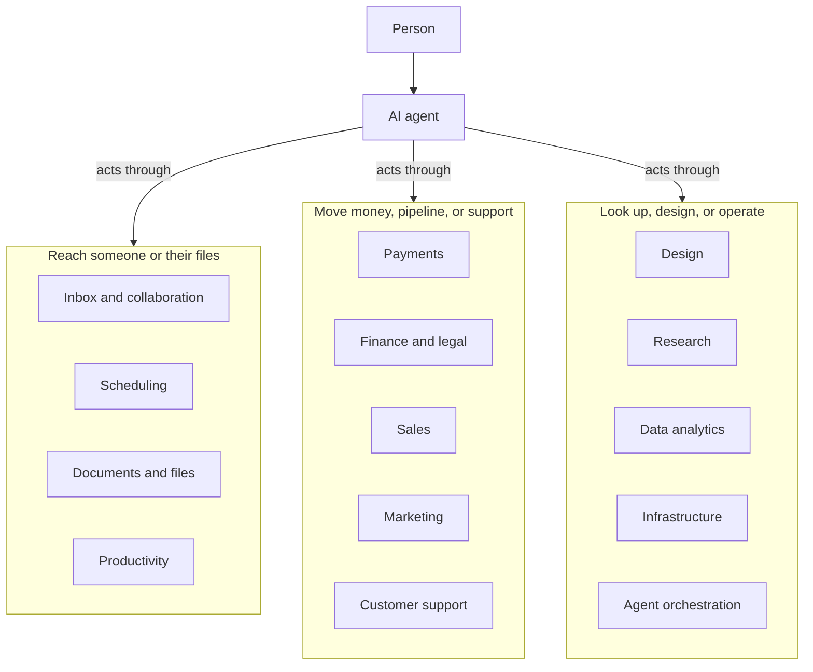

# Awesome-Agent-Services

[](https://0xWelt.github.io/Awesome-Agent-Services/)
[](https://github.com/0xWelt/Awesome-Agent-Services)
[](https://github.com/0xWelt/Awesome-Agent-Services/fork)
[](https://creativecommons.org/licenses/by/4.0/)
[](https://awesome.re)

A curated list of services an AI agent can call to get something done in the real world or in a person's accounts.

Mail, calendar, files, payments, scheduling, support, sales, and similar fulfillment and transaction surfaces belong here. This is not another MCP-server directory, and it is not a dump of adapters, skills, or protocol wrappers. Coding harnesses and coding-oriented tools stay in [Awesome-Vibe-Coding](https://github.com/0xWelt/Awesome-Vibe-Coding). Named personal-agent products (Grok Bot, Dots, Claude Duet, Muse, Manus, OpenClaw, Hermes Agent) stay in [Awesome-Personal-Agents](https://github.com/0xWelt/Awesome-Personal-Agents).

🌐 **Live Website**: [https://0xWelt.github.io/Awesome-Agent-Services/](https://0xWelt.github.io/Awesome-Agent-Services/)

> **Content structure**: tools are organized in the [`contents/`](contents/) directory — one
> markdown file per tool, grouped by category, with `_meta.md`
> files describing each folder. The live website is generated from these files
> by `yaal/scripts/parse-readme.js`.

## Architecture

An agent sits between a person and the services that actually move work: inboxes, calendars, files, payments, and the systems of record around them.



## Categories

| Category | Description | Location |
| --- | --- | --- |
| Inbox and Collaboration | Email, chat, newsletters, and team messaging an agent can read or send. | [contents/inbox-and-collaboration/](contents/inbox-and-collaboration/) |
| Scheduling | Calendars and meetings an agent can search, book, or update. | [contents/scheduling/](contents/scheduling/) |
| Documents and Files | Documents, drives, and file stores an agent can search or edit. | [contents/documents-and-files/](contents/documents-and-files/) |
| Productivity | Tasks, notes, knowledge bases, and workspaces an agent uses to get work done. | [contents/productivity/](contents/productivity/) |
| Payments | Payments, banking, billing, and checkout an agent can query or act on. | [contents/payments/](contents/payments/) |
| Finance and Legal | Accounting, payroll, agreements, and compliance systems. | [contents/finance-and-legal/](contents/finance-and-legal/) |
| Sales | CRM, prospecting, enrichment, and outreach. | [contents/sales/](contents/sales/) |
| Marketing | Campaigns, audiences, and publishing. | [contents/marketing/](contents/marketing/) |
| Customer Support | Help desks and support inboxes. | [contents/customer-support/](contents/customer-support/) |
| Design | Design, media, and visual creation tools an agent can operate. | [contents/design/](contents/design/) |
| Research | Search, SEO, web data, and company research. | [contents/research/](contents/research/) |
| Data Analytics | Product analytics, experimentation, warehousing, and data platforms. | [contents/data-analytics/](contents/data-analytics/) |
| Infrastructure | Cloud, hosting, data stores, observability, and security platforms an agent can operate. | [contents/infrastructure/](contents/infrastructure/) |
| Agent Orchestration | Workflow and automation platforms that connect work across tools. | [contents/agent-orchestration/](contents/agent-orchestration/) |

## Adding a service

Create a markdown file in the matching `contents/` folder:

```markdown
---
name: Service Name
link: https://example.com
tags: [grok-bot]
---

One to three factual sentences about what the service does.
```

Required frontmatter is `name` and `link`. Optional `tags` are short labels. Include `grok-bot` when the service appears in Grok Bot Connect Apps. Do not add a `command` field. Use the official product homepage or docs hub, without UTM, referral, or affiliate parameters.

Add a service when an agent can call it to get something done in the world or in a person's accounts. Do not add an MCP server, adapter, skill pack, or protocol wrapper as its own entry. Do not add coding harnesses (those belong in Awesome-Vibe-Coding) or named personal-agent products (those belong in Awesome-Personal-Agents). Put each product in one category. Prefer a separate file over editing an existing one.

## Repo Status


## Contributors

This project exists thanks to all the people who contribute.

<a href="https://github.com/0xWelt/Awesome-Agent-Services/graphs/contributors">
  
</a>

## Star History

[](https://star-history.com/#0xWelt/Awesome-Agent-Services&Date)

## License

[](https://creativecommons.org/licenses/by/4.0/)

This work is licensed under a
[Creative Commons Attribution 4.0 International License](http://creativecommons.org/licenses/by/4.0/).
