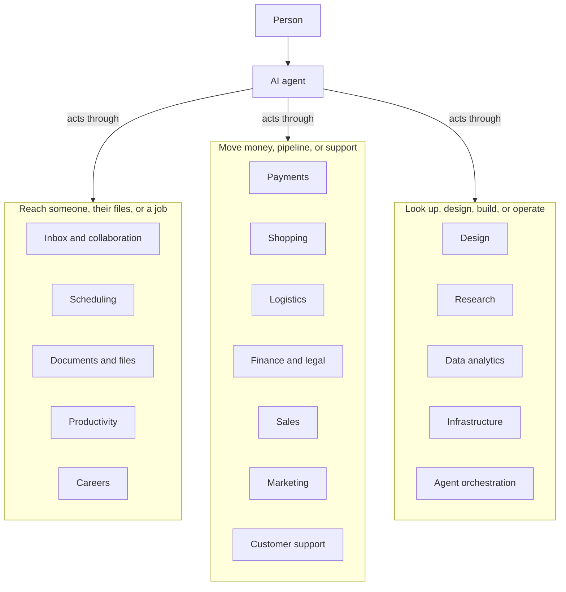

# Awesome-Agent-Services

[](https://0xWelt.github.io/Awesome-Agent-Services/)
[](https://github.com/0xWelt/Awesome-Agent-Services)
[](https://github.com/0xWelt/Awesome-Agent-Services/fork)
[](https://creativecommons.org/licenses/by/4.0/)
[](https://awesome.re)

A complete collection of supporting tools and supporting services an AI agent can call.

Fulfillment services (mail, calendar, files, payments, and the rest), infrastructure and code hosts (AWS, Vercel, GitHub, Docker, Kubernetes, and their CLIs), and code-related supporting tools (observability, context, skill directories) belong here. Entries are the tool or service. Connection methods are tags, not categories. Coding harnesses and Lovable-like app builders (Bolt.new, Replit, Lovable, Firebase Studio, Cursor, Claude Code) stay in [Awesome-Vibe-Coding](https://github.com/0xWelt/Awesome-Vibe-Coding). Named personal-agent products stay in [Awesome-Personal-Agents](https://github.com/0xWelt/Awesome-Personal-Agents).

🌐 **Live Website**: [https://0xWelt.github.io/Awesome-Agent-Services/](https://0xWelt.github.io/Awesome-Agent-Services/)

> **Content structure**: tools are organized in the [`contents/`](contents/) directory — one
> markdown file per tool, grouped by category and subcategory, with `_meta.md`
> files describing each folder. The live website is generated from these files
> by `yaal/scripts/parse-readme.js`.

## Architecture

An agent sits between a person and the tools that move work: inboxes, calendars, files, payments, cloud and code hosts, and the supporting tools around them.



## Categories

| Category | Description | Location |
| --- | --- | --- |
| Inbox and Collaboration | Email, team chat, business messaging, and social accounts an agent can read or send. | [contents/inbox-and-collaboration/](contents/inbox-and-collaboration/) |
| Scheduling | Calendars and meetings an agent can search, book, or update. | [contents/scheduling/](contents/scheduling/) |
| Documents and Files | Documents, drives, and file stores an agent can search or edit. | [contents/documents-and-files/](contents/documents-and-files/) |
| Productivity | Work management, knowledge, meetings, creative tools, sites, forms, hiring, and automation an agent uses to get work done. | [contents/productivity/](contents/productivity/) |
| Careers | Job search, matching, and applications an agent can run for a person. | [contents/careers/](contents/careers/) |
| Payments | Checkout and billing, banking and spend, crypto and wallets, and brokerage an agent can query or act on. | [contents/payments/](contents/payments/) |
| Shopping | Stores and delivery services an agent can use to find goods, run a shop, or place an order. | [contents/shopping/](contents/shopping/) |
| Logistics | Freight booking, rates, and shipment tracking. | [contents/logistics/](contents/logistics/) |
| Finance and Legal | Accounting and spend, agreements, risk and compliance, and market data. | [contents/finance-and-legal/](contents/finance-and-legal/) |
| Sales | CRM, prospecting, enrichment, and outreach. | [contents/sales/](contents/sales/) |
| Marketing | Advertising, lifecycle messaging, social publishing, and content operations. | [contents/marketing/](contents/marketing/) |
| Customer Support | Help desks and support inboxes. | [contents/customer-support/](contents/customer-support/) |
| Design | Voice, image and video, diagrams, presentations, and interface design an agent can operate. | [contents/design/](contents/design/) |
| Research | Search, literature, directories, SEO, web data, and company research. | [contents/research/](contents/research/) |
| Data Analytics | Product analytics, business intelligence, experimentation, data platforms, search, web data, observability, and model evaluation. | [contents/data-analytics/](contents/data-analytics/) |
| Infrastructure | Cloud, hosting, code hosts, containers, databases, security, build tools, and the other platforms an agent can operate. | [contents/infrastructure/](contents/infrastructure/) |
| Agent Orchestration | Workflows, agent platforms, observability, context, packs, companions, memory, and browsers. | [contents/agent-orchestration/](contents/agent-orchestration/) |

## Adding a service

Create a markdown file in the matching `contents/` folder:

```markdown
---
name: Service Name
link: https://example.com
tags: [mcp, grok-bot]
---

One to three factual sentences about what the service does.
```

Required frontmatter is `name` and `link`. Do not add a `command` field. Use the official product homepage or docs hub, without UTM, referral, or affiliate parameters. Never link an MCP install URL, a skill gist, or a `cursor.com/grok-bot/link/v1/plugin/add` URL.

`tags` record verified connection methods. The vocabulary is `mcp` (official or vendor-hosted MCP server), `skill` (Agent Skill the vendor ships), `grok-bot` (Grok Bot Connect Apps catalog), `cli` (official command-line interface), and `chatgpt` (official ChatGPT app or Actions published by the vendor). Add a tag only when that surface is real. A Grok Bot connector is not automatically `mcp`. Do not create a category or subcategory for a connection method.

Add a service when an agent can call it to get something done in the world or in a person's accounts. Do not add an MCP server, adapter, skill pack, or protocol wrapper as its own entry. Do not add coding harnesses (those belong in Awesome-Vibe-Coding) or named personal-agent products (those belong in Awesome-Personal-Agents). Put each product in one category. Prefer a separate file over editing an existing one.

## Repo Status


## Contributors

This project exists thanks to all the people who contribute.

<a href="https://github.com/0xWelt/Awesome-Agent-Services/graphs/contributors">
  
</a>

## Star History

[](https://star-history.com/#0xWelt/Awesome-Agent-Services&Date)

## License

[](https://creativecommons.org/licenses/by/4.0/)

This work is licensed under a
[Creative Commons Attribution 4.0 International License](http://creativecommons.org/licenses/by/4.0/).
